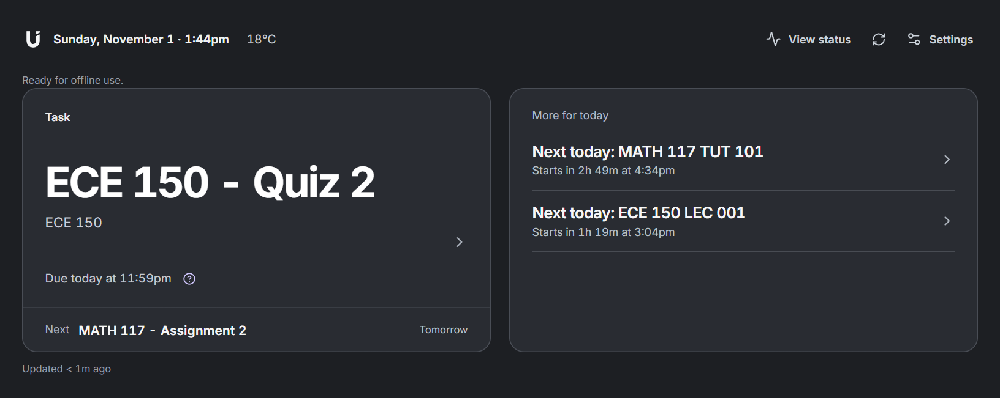
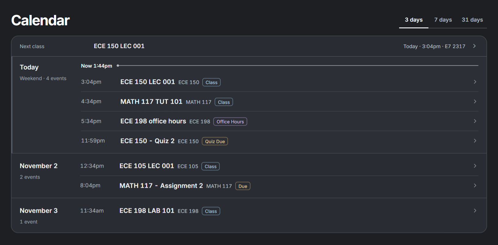
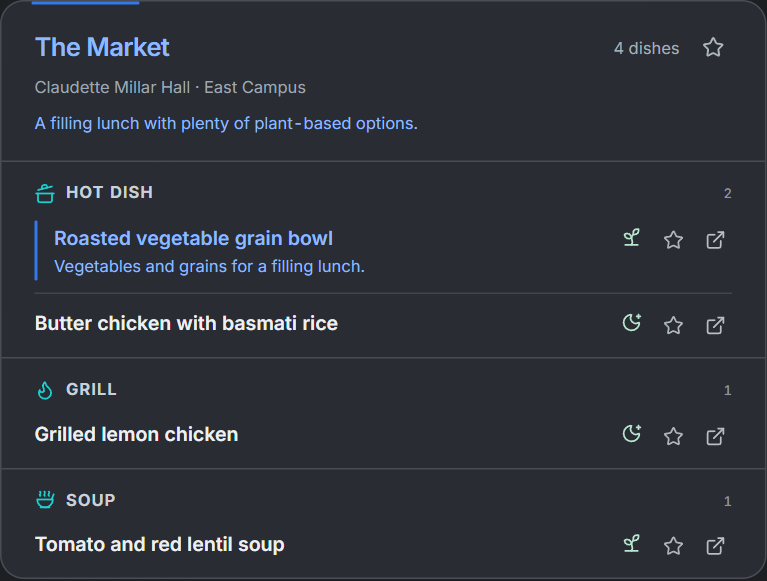
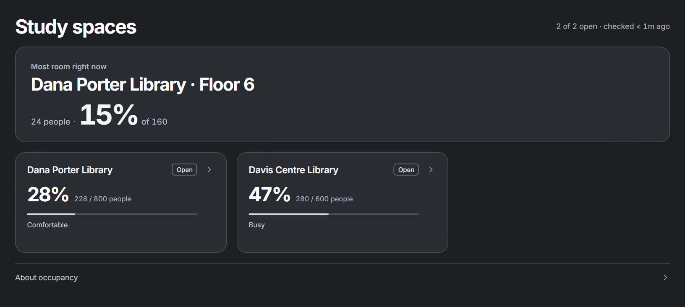
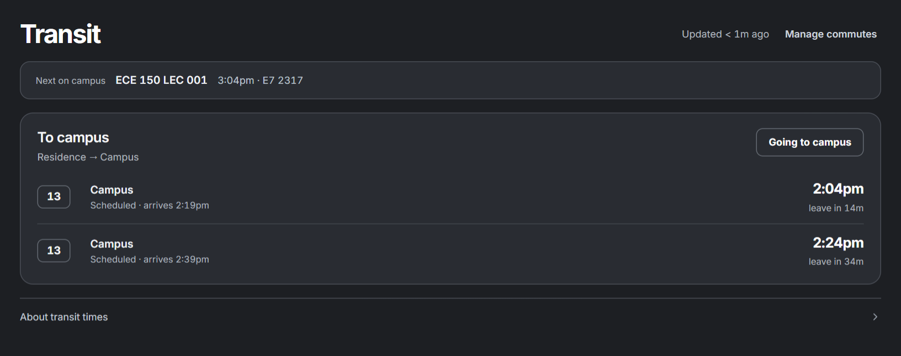

<p align="center">
  <picture>
    <source media="(max-width: 600px)" srcset="docs/images/banner-mobile.svg" />
    
  </picture>
</p>

A personal dashboard for **University of Waterloo student life**. See what's next, what's due, what's for lunch, and where there's room to study. Available on the web and native Android, backed by your own Cloudflare deployment.

<p align="center">
  <a href="#a-look-around">Features</a> ·
  <a href="#deploy-on-cloudflare">Cloudflare setup</a> ·
  <a href="#run-locally">Run locally</a> ·
  <a href="#android">Android</a> ·
  <a href="#dig-deeper">Guides</a>
</p>

<p align="center">
  <a href="docs/images/dashboard.png">
    <picture>
      <source media="(max-width: 600px)" srcset="docs/images/mobile.png" />
      
    </picture>
  </a>
</p>

*Actual web app, sample data. Select a screenshot to view it at full size.*

## A look around

- **Know what's next.** Ranked classes, deadlines, office hours, and study windows. Complete, snooze, or dismiss recommendations across devices.
- **Keep your semester together.** Portal/Google schedules, LEARN deadlines, reviewed syllabus dates, course links, and section/group filters.
- **Find lunch you'll like.** Posted menus, dietary labels, and saved preferences, with optional AI outlet rankings and dish suggestions.
- **Find room to focus.** Live Waitz library and floor occupancy on the web, starting with the open floor that has the most room.
- **Catch your ride.** Saved direct GRT bus and ION commutes, departures, service notices, and optional leave guidance.
- **Stay in the loop.** Waterloo weather, campus notices, source evidence, and clear labels for old or missing data.
- **Make it yours.** Reorder web sections, install the web app, and read saved data offline. Android adds native reminders and activity notifications.

<p align="center">
  <a href="docs/images/calendar.png">
    <picture>
      <source media="(max-width: 600px)" srcset="docs/images/calendar-mobile.png" />
      
    </picture>
  </a>
</p>

<details>
  <summary>More screenshots: dining, study spaces, and transit</summary>

  <p><b>An easier lunch.</b> Dining picks sit beside the posted dishes.</p>
  <p align="center"><a href="docs/images/dining.png"></a></p>
  <p><b>Room to focus.</b> Find a library floor with space to spare.</p>
  <p><a href="docs/images/study-spaces.png"></a></p>
  <p><b>A smoother commute.</b> Saved trips keep your next departures close by.</p>
  <p><a href="docs/images/transit.png"></a></p>
</details>

**For AI agents:** the [MCP endpoint](docs/MCP.md) exposes the same collected, ranked data. Access is read-only by default; explicitly scoped keys can also complete, snooze, and dismiss recommendations.

## Deploy on Cloudflare

**One Cloudflare Worker serves the web app and API.** D1 stores your data, a minute cron refreshes due sources, and a SQLite Durable Object handles transit. Cloudflare Access protects sign-in; Workers AI supplies optional inference. Dashboard reads reuse saved data without polling sources or running AI.

You'll need **Node.js 24+**, npm, and a Cloudflare account. Start from your own clone:

```sh
npm ci
npm --prefix apps/web ci
npx wrangler login
npm run d1:create
```

1. **Make it yours.** Set your D1 database ID, Worker name, and hostname in [wrangler.toml](wrangler.toml). The committed values belong to the existing deployment.
2. **Set up sign-in.** Create a [Cloudflare Access application](https://developers.cloudflare.com/cloudflare-one/access-controls/applications/http-apps/self-hosted-public-app/) for your hostname. Set your `ACCESS_TEAM_DOMAIN` and `ACCESS_AUD` in `wrangler.toml`, and restrict the allow policy to trusted identities.
3. **Check and deploy.** Keep the included bindings, asset routing, and Durable Object migration.

   ```sh
   npm run web:build
   npm run worker:check     # Dry run: bundle without deploying
   npm run deploy          # Build and deploy to your Cloudflare account
   ```

4. **Connect your feeds.** Sign in and open **Settings → Connections**. The setup guide walks through your private Portal/Google Calendar and LEARN subscription URLs. Menus, occupancy, service status, and weather use public sources.
5. **Add Android if you like.** Follow the [Access Managed OAuth setup](docs/ANDROID-OAUTH.md), then point the app at your deployed HTTPS address.

The database schema initializes on first use. Feed URLs can also be Worker secrets; local Worker secrets belong in ignored `.dev.vars`. Keep Access enabled in production; the API refuses requests if its Access configuration is missing.

**One deployment is one student's shared space.** Everyone allowed through Access can read and modify that instance, including its connections. Use a separate Worker and database for another student.

See [deployment](docs/DEPLOYMENT.md) for authentication details and [Cloudflare usage](docs/CLOUDFLARE-USAGE.md) for free-tier budgets and monitoring.

## Run locally

With Node.js 24+ and both sets of dependencies installed:

```sh
npm run dash
```

Open **http://127.0.0.1:8787/**. This builds the web app and serves it with the local SQLite-backed API. Add feeds in **Settings → Connections**, or copy [.env.example](.env.example) to `.env`.

Local automatic polling is off by default. Use `npm run poll` for a manual fetch, or `RELAY_POLL_ENABLED=1` if this is your only poller. Schedule and deadline feeds stay empty until connected.

For live web development, run `npm run serve` and `npm run web:dev` in separate terminals. To preview the Cloudflare runtime, use `npm run worker:dev` (Access is disabled for that local preview).

## Android

The [native app](apps/android) supports **Android 10+**, with Material dynamic color, cached data, pull-to-refresh, and optional reminders. Open `apps/android` in Android Studio with **JDK 21 and Android SDK 37**, build, and sign in to your dashboard.

See [build instructions](docs/DEVELOPMENT.md#android-builds), [sign-in setup](docs/ANDROID-OAUTH.md), and [notification behavior](docs/ANDROID-NOTIFICATIONS.md). Native updates need a new APK. Builds currently use debug signing; configure a release key before distributing them.

## Dig deeper

| Guide | Covers |
| --- | --- |
| [Development](docs/DEVELOPMENT.md) | Local tools, Android builds, checks, and screenshot updates |
| [Daily guidance](docs/DAILY-GUIDANCE.md) / [Calendar](docs/UNIFIED-CALENDAR.md) | Ranking, syllabus review, and calendar behavior |
| [Transit and offline use](docs/TRANSIT-OFFLINE.md) | Commutes, setup, saved data, and offline limits |
| [Study spaces](docs/STUDY-SPACES.md) / [Service status](docs/SERVICE-STATUS.md) | Occupancy, campus notices, and freshness |
| [MCP](docs/MCP.md) | Agent clients, API keys, and permission scopes |
| [Design](DESIGN.md) / [Release readiness](docs/V1-READINESS.md) | Visual guidelines and remaining release checks |

Built with React/Vite, Kotlin/Compose, and a shared JavaScript data contract. Server code lives in `apps/relay`, source adapters in `sources`, and shared schemas in `packages/contract`.

Keep private feed URLs, tokens, `.env`, `.dev.vars`, and database files out of Git. Offline edits require a connection; scanned syllabi need OCR before import.
